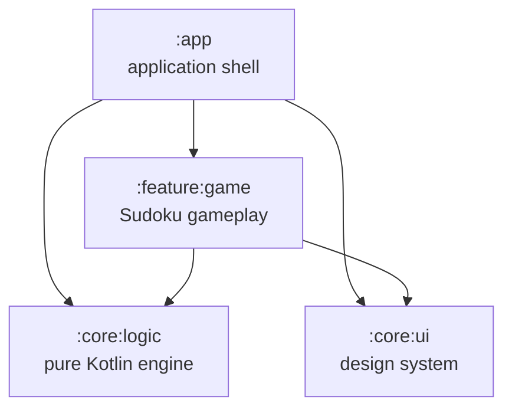
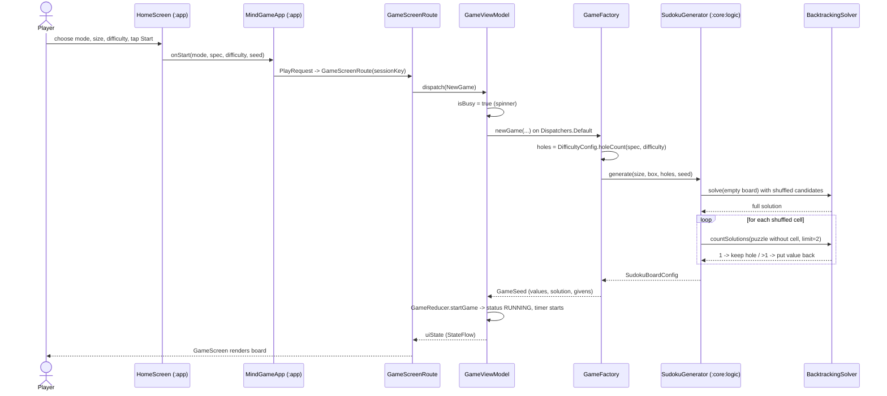
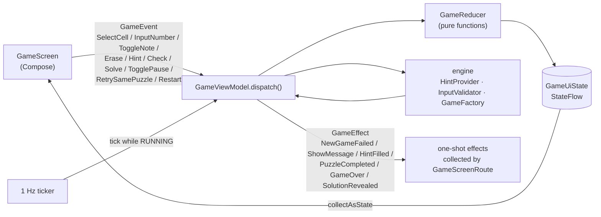
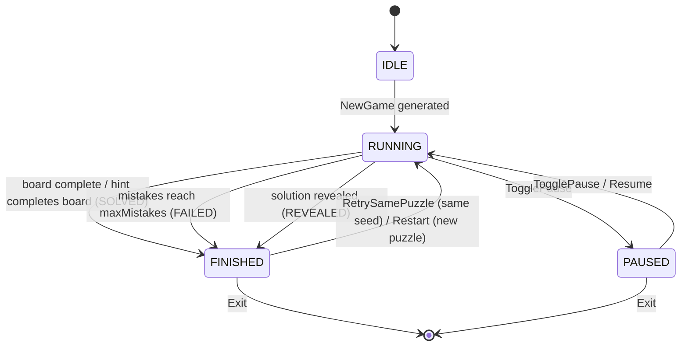
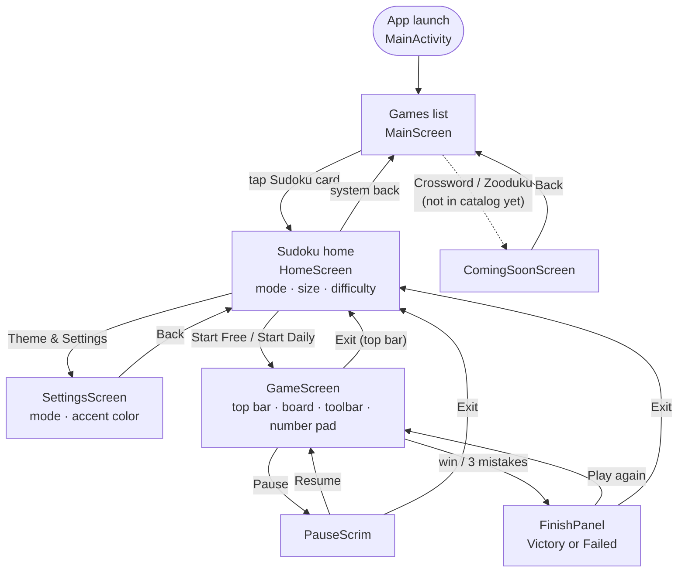

# Mind Game

An Android puzzle-game app built with Kotlin and Jetpack Compose. The first (and currently only) playable game is **Sudoku** in three sizes — 4×4, 6×6 and 9×9 — with every puzzle generated on-device: no bundled puzzle files, and each puzzle is checked to have exactly one solution.

- **Free mode**: pick a board size and difficulty; each game is a new random puzzle.
- **Daily mode**: a puzzle seeded from today's date, so everyone gets the same board for a given day and size.
- **In-game tools**: pencil notes, erase, limited hints, check, debug-only solution reveal, pause, timer and configurable lives.
- **Theming**: System / Light / Dark mode and four accent palettes (Lilac, Ocean, Forest, Sunset), applied live.

---

## Tech stack

| Area | Choice |
|---|---|
| Language | Kotlin 2.2.10 (JVM target 17) |
| UI | Jetpack Compose (BOM 2024.09.00), Material 3 |
| Architecture | Single-activity, MVI (`State` / `Event` / `Effect` + pure reducer) |
| Async | Kotlin Coroutines + `StateFlow` / `Channel` |
| Build | Gradle 9.5 wrapper, AGP 9.3.2, version catalog (`gradle/libs.versions.toml`), convention plugins in `buildSrc/` |
| SDK | `compileSdk` = `targetSdk` = `minSdk` = 36 (`buildSrc/src/main/kotlin/Config.kt`) |
| Tests | JUnit 4, `kotlinx-coroutines-test` |

---

## Project structure

```text
mind-game/
├── app/                 # Application shell: MainActivity, navigation, menus, settings
├── core/
│   ├── logic/           # Pure Kotlin/JVM Sudoku engine (generate / solve / validate / difficulty)
│   └── ui/              # Design system: theme, palettes, typography, fonts, shared text components
├── feature/
│   └── game/            # Sudoku gameplay: MVI ViewModel, reducer, game engine adapters, game UI
├── buildSrc/            # Gradle convention plugins + shared Config (SDK levels, namespaces)
├── gradle/              # Wrapper + version catalog
└── docs/                # Design docs, implementation plans, UI mockups
```

### Module dependency graph



`:core:logic` has no Android dependency, so it can be unit-tested on the plain JVM and later moved to Kotlin Multiplatform.

---

## Modules

### `:app` — application shell
Plugins: `mindgame.android.application`, `mindgame.android.application.compose`

| File | Responsibility |
|---|---|
| `MainActivity` | Single activity; enables edge-to-edge and hosts `MindgameRoot` + `MindGameApp`. |
| `sudoku/MindgameRoot` | App root: owns `ThemePrefs` and wraps everything in `MindgameTheme`, so theme changes recompose the whole tree. |
| `sudoku/MindGameApp` | Lightweight in-app navigation: a saveable back stack of `Dest` (`Games`, `GameDetail`, `Settings`) plus a `PlayRequest` that shows the game screen on top. System back pops the stack via `BackHandler`. |
| `mainpage/MainScreen`, `GameCard` | Games list (`LazyColumn`) built from `gameCatalog`. |
| `main/model/GameEntry` | `GameEntry` / `GameId` (`SUDOKU`, `CROSSWORD`, `ZOODUKU`) and the `gameCatalog` (currently Sudoku only). |
| `sudoku/HomeScreen` | Sudoku start screen: choose mode (Free / Daily), board size and difficulty, then start; link to Settings. Daily mode uses the hardest difficulty available for the size and `LocalDate.now().toEpochDay()` as the seed. |
| `sudoku/SettingsScreen` | Appearance settings: brightness mode and accent palette. |
| `sudoku/ThemePrefs` | `SharedPreferences`-backed theme store exposed as Compose state. |
| `sudoku/ComingSoonScreen` | Placeholder for games without gameplay yet (Crossword, Zooduku). |
| `sudoku/PlayRequest` | Parameters for one game session (mode, spec, difficulty, seed, unique id). |

### `:core:logic` — Sudoku engine (pure Kotlin/JVM)
Plugin: `mindgame.kotlin.library`. Full documentation: [`core/logic/docs/README.md`](core/logic/docs/README.md).

| Package | Key types | Responsibility |
|---|---|---|
| `model` | `SudokuBoardConfig` | Board data: `size`, `boxWidth`, `boxHeight`, `solution`, `puzzle`, `holes`. Boards are flat `IntArray`s indexed `row * size + col`; `0` = empty. |
| `solver` | `SolverStrategy`, `BacktrackingSolver`, `SudokuSolver` | Backtracking solver for any box shape; `solve` returns one solution and `countSolutions(limit = 2)` is used for the uniqueness check. |
| `generator` | `SudokuGenerator`, `RandomProvider` | Builds a random full board, then removes cells one by one, keeping a removal only if the puzzle still has a unique solution. Retries on a new board (up to 50 times) if the target hole count can't be reached. A seed is mixed as `seed * 10 + size`. |
| `validator` | `PuzzleValidator`, `PuzzleValidationResult` | Classifies a puzzle as `VALID` (unique solution), `MULTIPLE_SOLUTIONS` or `NO_SOLUTION`. |
| `config` | `BoardSpec`, `Difficulty`, `DifficultyConfig`, `GameRemoteConfig`, `GameConfigParser`, `GameRules` | Board sizes, difficulty → hole-count mapping, and game configuration parsing and rules. |

Default hole counts (`DifficultyConfig.default()`):

| Difficulty | 4×4 | 6×6 | 9×9 |
|---|---|---|---|
| Easy | 3 | 10 | 36 |
| Medium | 5 | 14 | 42 |
| Hard | 6 | 18 | 48 |
| Expert | — | 20 | 55 |

#### Game config

`app/src/main/assets/game_config.json` is the bundled offline config for Sudoku hole counts, generator `max_retry`, lives and hints rules, and the daily `seed_salt`. Rewards, ads and feature flags are parsed but reserved for later phases. See the [game config schema and rollout plan](docs/game_config_json.md).

### `:feature:game` — Sudoku gameplay
Plugins: `mindgame.android.library`, `mindgame.android.library.compose`

| Package | Key types | Responsibility |
|---|---|---|
| `mvi` | `GameUiState`, `GameEvent`, `GameEffect`, `GameViewModel` | MVI contract. `GameUiState` is an immutable snapshot (`config`, `board`, `selection`, `progress`). The ViewModel is the single state owner: `dispatch(GameEvent)` in, `uiState: StateFlow` and `effect: Flow<GameEffect>` out. Puzzle generation runs on an injectable dispatcher; a 1 Hz coroutine drives the timer. |
| `reducers` | `GameReducer` | Pure `(GameUiState, input) -> GameUiState` functions (select, input, notes, erase, pause, finish with `GameOutcome`, …). |
| `engine` | `GameFactory`, `GameSeed`, `HintProvider`, `InputValidator` | Adapts `:core:logic` for the UI: `GameFactory` turns (mode, spec, difficulty, seed) into a `GameSeed` (values, solution, givens); `HintProvider` gives hints and checks answers against the solution; `InputValidator` detects conflicts and completion. |
| `ui` | `GameScreenRoute`, `GameScreen`, `GameTopBar`, `GameBoard`, `CellView`, `GameToolBar`, `NumberPad`, `BoardGeometry` | `GameScreenRoute` creates one `GameViewModel` per session (`sessionKey`), dispatches `NewGame`, and collects one-shot effects into snackbars; `GameScreen` renders `GameUiState`. |
| `ui/components` | `PauseScrim`, `FinishPanel` | Pause overlay (resume or exit) and outcome panel (retry, new game, or exit). |
| root | `GameMode` (`FREE`, `DAILY`), `GameStatus` (`IDLE`, `RUNNING`, `PAUSED`, `FINISHED`), `GameOutcome` (`SOLVED`, `FAILED`, `REVEALED`) | Shared enums. |

### `:core:ui` — design system
Plugins: `mindgame.android.library`, `mindgame.android.library.compose`

| Package | Responsibility |
|---|---|
| `theme` | `MindgameTheme(scheme, mode)`, `AppThemeMode` (System / Light / Dark), `AppThemeScheme` (Lilac / Ocean / Forest / Sunset), `Theme` accessors. |
| `primitives` | Color schemes per palette (`schemeFor`), typography, font sizes, font family (Klee One, bundled under OFL — see `docs/OFL.txt`). |
| `components` | `BaseText` and `TextConfig`. |
| `util` | `VisibilityConfig`. |

### `buildSrc` — convention plugins

| Plugin id | Class | Applies |
|---|---|---|
| `mindgame.android.application` | `AndroidApplicationConventionPlugin` | AGP application + Kotlin Android, SDK levels from `Config`, Java/JVM 17, minified release build. |
| `mindgame.android.application.compose` | `AndroidApplicationComposeConventionPlugin` | Compose compiler plugin, Compose BOM, tooling. |
| `mindgame.android.library` | `AndroidLibraryConventionPlugin` | AGP library + Kotlin Android, SDK levels, Java/JVM 17. |
| `mindgame.android.library.compose` | `AndroidLibraryComposeConventionPlugin` | Same Compose setup for libraries. |
| `mindgame.kotlin.library` | `KotlinJvmConventionPlugin` | Kotlin JVM library, Java/JVM 17. |

---

## Workflow: from "Start" to a finished game



### In-game MVI loop



`GameEffect`s are emitted on `GameViewModel.effect`; `GameScreenRoute` collects messages and hint feedback into snackbars, while terminal effects are represented by the outcome panel.

Rules applied by `GameViewModel`:
- A wrong number (doesn't match the solution) adds a mistake; reaching `maxMistakes` ends the game with the `FAILED` outcome.
- Filling the last cell correctly or using a hint that completes the board ends the game with the `SOLVED` outcome. **Solve** reveals the solution with the distinct `REVEALED` outcome.
- **Check** highlights filled cells that don't match the solution, without changing the board.
- Hints have a configured budget; each fills the selected unresolved cell or the first unresolved cell, and further requests show “No hints left”.
- **Retry same puzzle** replays the stored puzzle from scratch. **New game** regenerates with the same parameters.

### Game status lifecycle



---

## UI flow



Navigation is plain Compose state in `MindGameApp` (no Navigation library yet). The game screen is shown on top of the back stack while a `PlayRequest` is set; exiting clears it and returns to the Sudoku home screen.

---

## Getting started

### Requirements
- JDK 17
- Android SDK with **platform 36** and build-tools 36.x (Android Studio, or `sdkmanager "platforms;android-36" "build-tools;36.0.0"`)
- A device or emulator running Android 16 (API 36) — `minSdk` is 36

If you're not using Android Studio, point Gradle at the SDK with `local.properties` (gitignored):

```properties
sdk.dir=/path/to/Android/Sdk
```

### Build, test, run

```bash
./gradlew assembleDebug          # APK -> app/build/outputs/apk/debug/app-debug.apk
./gradlew test                   # all JVM unit tests
./gradlew :core:logic:test       # engine tests only
./gradlew :feature:game:test     # gameplay tests only
./gradlew installDebug           # install on a connected device/emulator
```

**CI:** GitHub Actions runs on pull requests and pushes to `develop` and `main`. Its Unit tests job runs `./gradlew test`, the Debug build job runs `assembleDebug` and uploads the `app-debug-apk` artifact, and the Android instrumented tests job runs `connectedDebugAndroidTest` on an API 36 `google_apis` x86_64 emulator.

Unit tests cover the solver, generator, validator, difficulty table and a puzzle reliability suite (`:core:logic`), and the reducer, UI state, board geometry, hint provider, input validator and game factory (`:feature:game`).

---

## Docs

| Document | Content |
|---|---|
| [`docs/sudoku_design.md`](docs/sudoku_design.md) | Generation / solving / validation design (v2.0). |
| [`docs/sudoku_feature_game_plan.md`](docs/sudoku_feature_game_plan.md) | `feature:game` implementation plan (MVI). |
| [`docs/main_screen_implementation_plan.md`](docs/main_screen_implementation_plan.md) | Main games-list screen plan. |
| [`docs/sudoku_ui_gap_analysis.md`](docs/sudoku_ui_gap_analysis.md) | Gap list between `GameScreen` and the target mockup. |
| [`docs/sudoku_ui.jpeg`](docs/sudoku_ui.jpeg), `docs/sudoku{44,66,99}-svg.svg` | UI mockup and board artwork. |
| [`core/logic/docs/README.md`](core/logic/docs/README.md) | Detailed engine documentation. |
